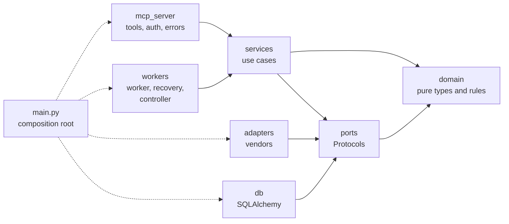
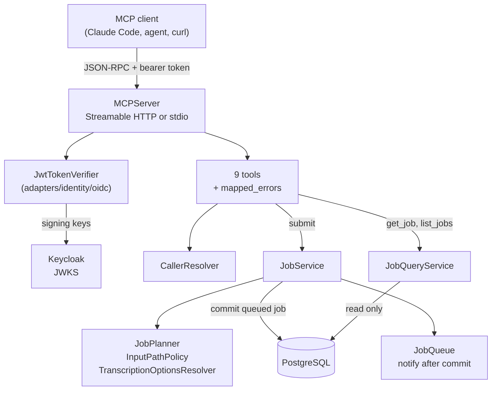
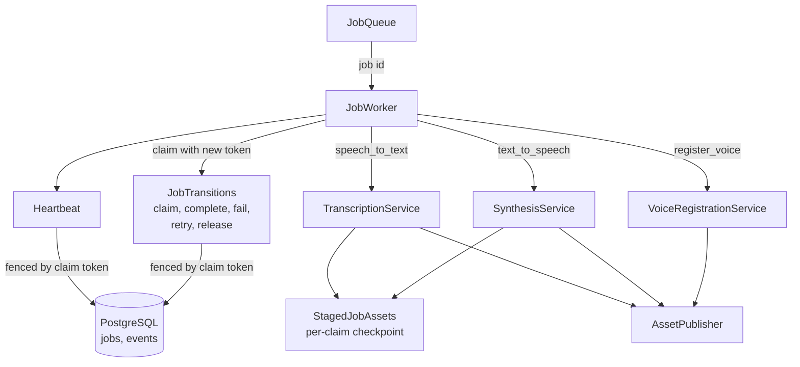
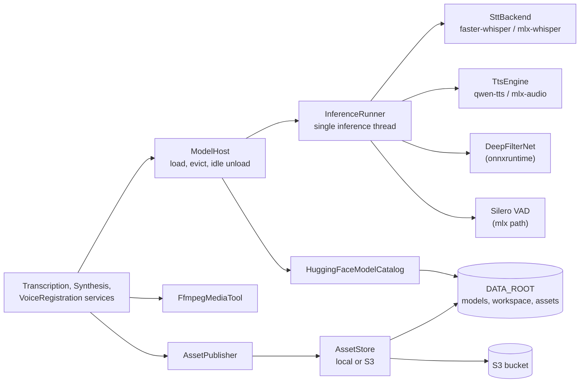
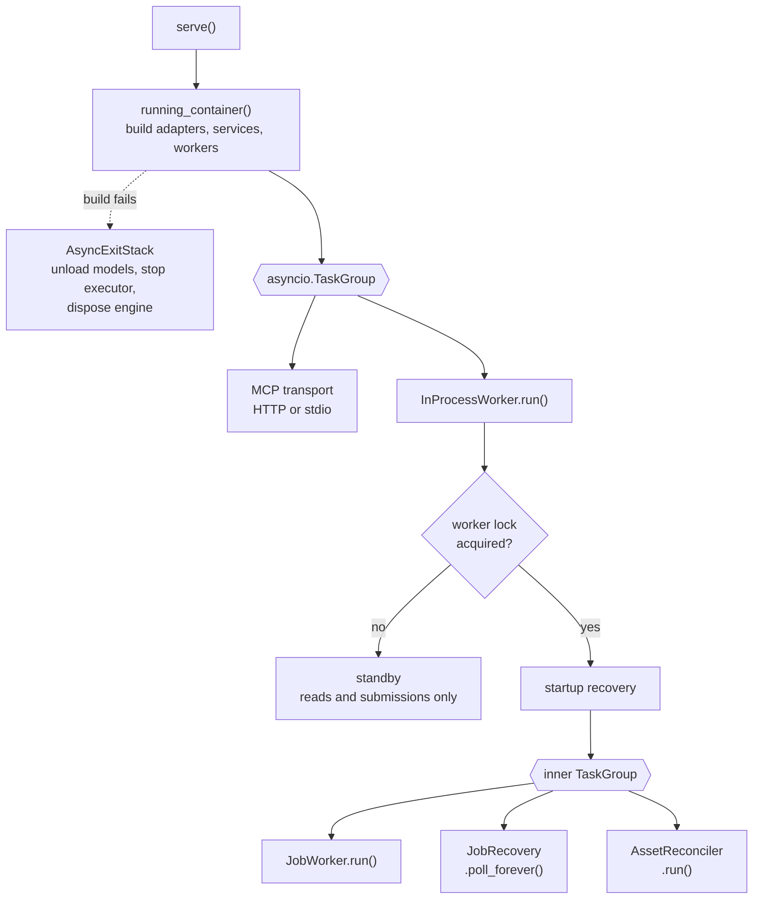
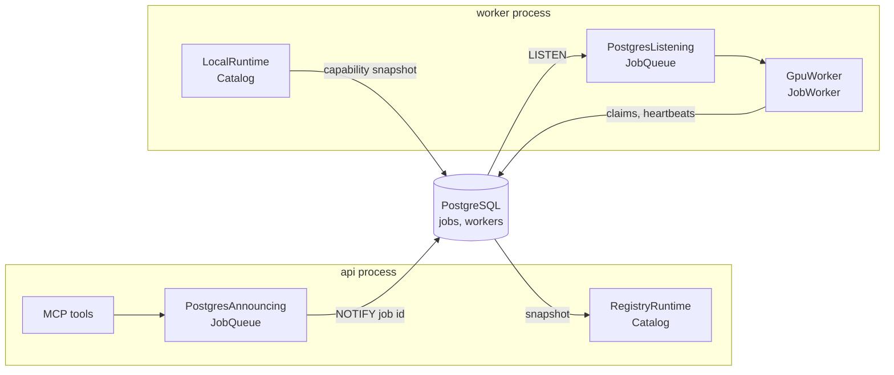
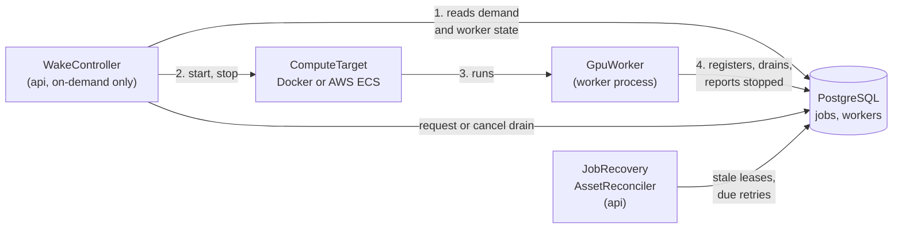

# Architecture

The system is described in small diagrams instead of one large one. Each answers one question:

| # | Diagram | Question it answers |
|---|---|---|
| 1 | [Layers](#1-layers-and-dependency-direction) | Which package may depend on which? |
| 2 | [Request path](#2-request-path-mcp-call-to-queued-job) | What happens when an MCP tool is called? |
| 3 | [Job execution](#3-job-execution-on-the-worker) | How does a worker run a job? |
| 4 | [Inference and storage](#4-inference-and-storage) | Where do models run, and where do files go? |
| 5 | [Single process](#5-processes-and-background-tasks-role-all) | What runs inside one `serve` process? |
| 6 | [Split roles](#6-split-roles-api-and-gpu-worker) | How do the api and GPU worker cooperate, and how does on-demand start work? |

`app/main.py` is the composition root: it is the only place that knows the concrete adapters.

## 1. Layers and dependency direction

import-linter enforces these arrows. An arrow means "may import".

- Dotted arrows: `main.py` builds and wires every package; it is the only module allowed to import them all.
- `services`, `workers` and `mcp_server` don't import `adapters` or `db`; they only see `ports`.
- Adapter categories (`stt`, `tts`, `compute`, `storage`, …) don't import each other.

## 2. Request path: MCP call to queued job

- Submissions commit the job first, then wake the worker. A lost wake-up only delays the job: polling finds it.
- `get_job` and `list_jobs` only read PostgreSQL and don't touch models.

## 3. Job execution on the worker

- Every write a worker makes to a running job requires its claim token, so a claim that lost its job changes nothing.
- Outputs are staged and committed before upload, so a retry republishes them without running inference again.

## 4. Inference and storage

- All native inference runs on one dedicated thread, so only one model works at a time.
- `models install` is the only step that downloads weights; at runtime models load from `DATA_ROOT/models`.

## 5. Processes and background tasks (role `all`)

`serve` (`app/main.py`) runs the MCP transport and `InProcessWorker.run()` in one `asyncio.TaskGroup`.

Only one process holds the PostgreSQL advisory lock and runs inference. Every other process serves tool calls (submissions, `get_job`, `list_jobs`), and the active worker picks those jobs up through recovery polling.

## 6. Split roles: api and GPU worker

`deployment.role` splits the same object graph across processes; see [gpu-worker.md](gpu-worker.md). The two processes share nothing but PostgreSQL and the asset store.

**6a. How a job crosses from the api to the worker**

- The api validates requests against the worker's last capability snapshot, so it needs no models.
- A missed `NOTIFY` only delays a job: the worker's `wake_queued` poll finds it.

**6b. How on-demand start and stop works**

- The controller is level-triggered: every tick it compares what should run with what runs, so new work during a shutdown simply leads to the next start.
- Recovery runs in the always-on api, so crashed jobs and due retries are handled while the GPU is stopped.

| Role | Built by | Background | Runtime catalog | Queue |
|---|---|---|---|---|
| `all` (default) | `build_container` | `InProcessWorker` as in §5, plus `IdleUnloader` when `idle_unload_seconds > 0` | `LocalRuntimeCatalog` | `AsyncioJobQueue` |
| `api` | `build_container` without `build_inference` | `PostgresAnnouncingJobQueue.run`, `RegistryRuntimeCatalog.run`, recovery polling, `AssetReconciler`, `WakeController.run` (only when `on_demand.enabled`) | `RegistryRuntimeCatalog` | `PostgresAnnouncingJobQueue` |
| `worker` | `gpu_worker_session` | `GpuWorker.run`: `JobWorker`, `wake_queued` poll, `PostgresListeningJobQueue.run`, `IdleUnloader`, registry heartbeat and drain | `LocalRuntimeCatalog` | `PostgresListeningJobQueue` |

The planner, options resolver, job, voice, model and health services depend on the `RuntimeCatalog` port (`app/ports/runtime.py`) instead of `ModelHost`, so the api validates requests from the worker's capability snapshot. Compute targets (`app/adapters/compute/`) are a separate adapter category, imported lazily and only when the master switch is on.