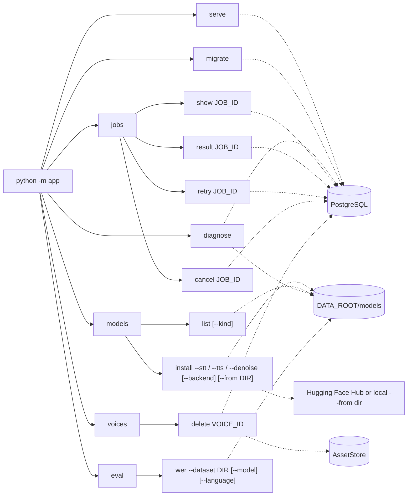
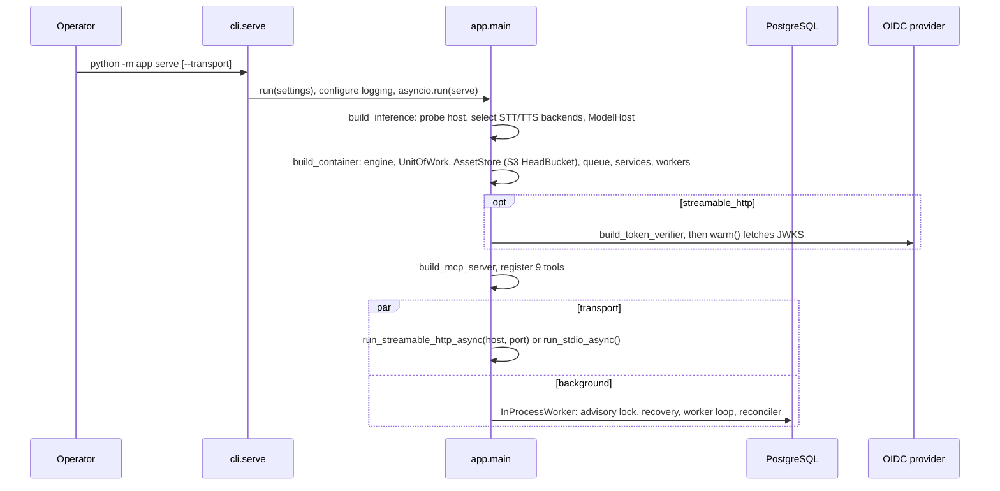
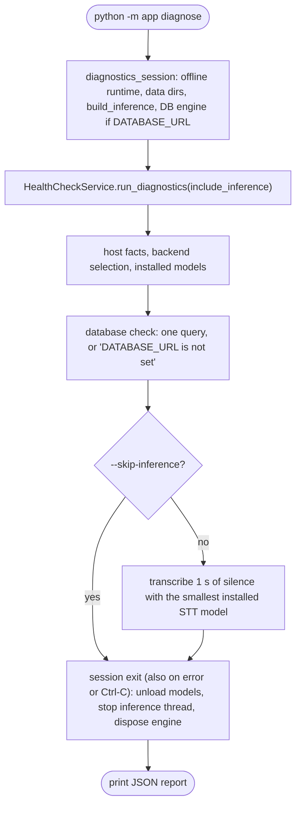
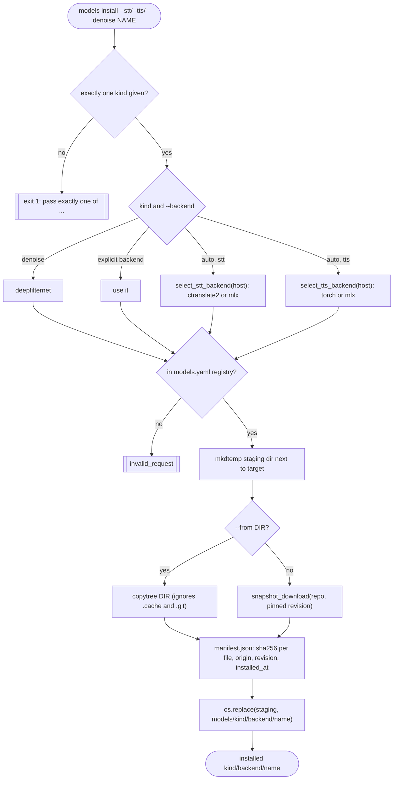
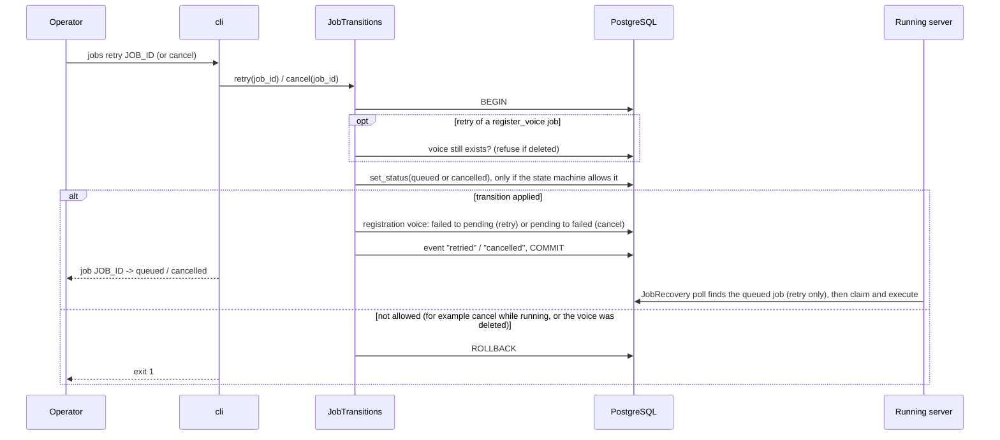
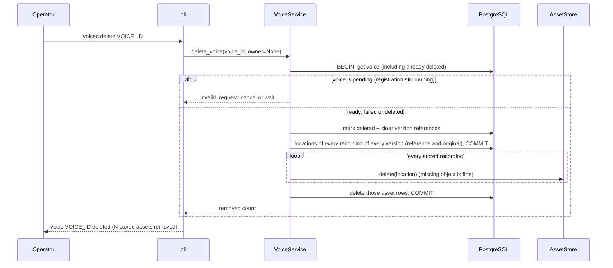
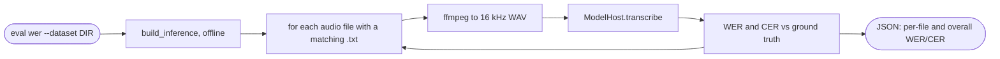

# CLI commands

Entry point: `python -m app` (Typer app in `app/cli.py`). Every command except `serve` loads settings with
transport `stdio`, so it doesn't need OAuth.

## Command map

| Command | What it does | Touches |
|---|---|---|
| `serve [--transport] [--role all\|api]` | Runs the MCP server and background worker (`all`), or the MCP server without models (`api`; see [gpu-worker.md](gpu-worker.md)) | DB, models (all), store, IdP |
| `worker [--register-only] [--preload kind:name]` | Runs the GPU worker role until it drains (exit 0), or only publishes its capability snapshot | DB, models, store |
| `gpu status/start/drain/stop [--force]` | Inspects the GPU worker's compute and the controller's decision now, or acts once (stop refused while a job runs) | DB, compute target |
| `migrate [revision] [--create-database]` | `alembic upgrade` to `head` or a given revision; creates a missing database first when asked | DB |
| `diagnose [--skip-inference]` | Host profile, backend selection, installed models, DB check, a 1 s STT probe (`HealthCheckService.run_diagnostics`) | host, models, DB |
| `models install` | The only command that downloads weights | network or `--from`, models dir |
| `models list` | Registry entries and whether each is installed | models dir |
| `jobs show/result` | Prints a job without an ownership check (trusted local CLI) | DB |
| `jobs retry/cancel` | Manual transitions through `JobTransitions`, keeping a registration's voice in step | DB |
| `voices delete` | Marks the voice deleted, purges every stored recording of every version, then drops their rows | DB, store |
| `eval wer` | Offline WER/CER against `.txt` ground truth | models |

## serve

## diagnose

The MCP `health_check` tool uses the same service's `check()`, which only runs dependency checks and doesn't load
weights or wait for the inference thread.

## models install

The atomic `os.replace` means a half-finished download doesn't look installed: the runtime only sees a model
once its `manifest.json` is present.

## jobs retry / cancel

## voices delete

If a storage delete fails, the asset rows are still there and the voice is already hidden; running the command again
finishes the purge. Deleting an object that is already missing is not an error. Only the server-managed copies
(processed reference and preserved original) are purged; the caller's original input file isn't touched.

## eval wer

