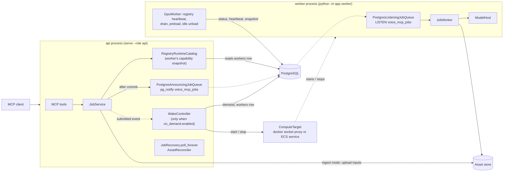
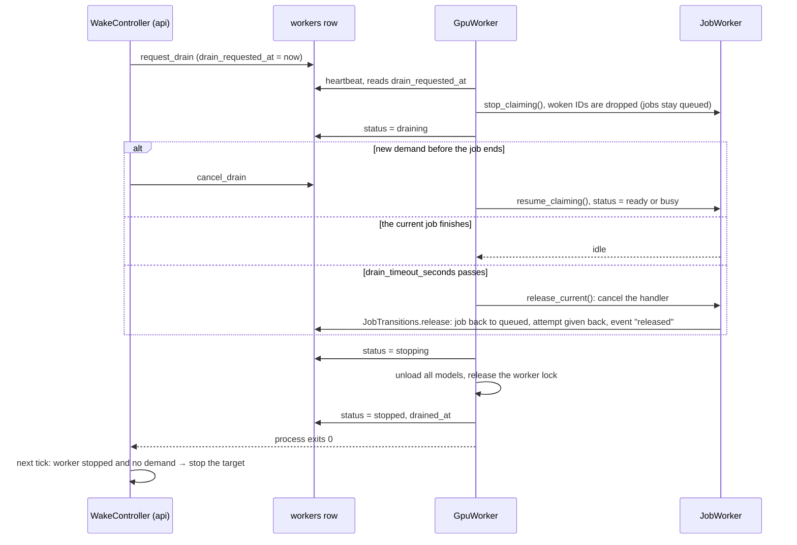

# Separate GPU worker with on-demand start

This feature lets inference run in its own process (on the same machine or another one), lets the MCP server start that process when work arrives and stop it when idle, and
moves audio between machines through the asset store when they share no filesystem.

**With default settings nothing changes:** one `all` process, no controller, inputs read from the submitted path.

## Roles

| Role | Command | Runs | Loads models? | Holds the worker lock? |
|---|---|---|---|---|
| `all` (default) | `python -m app serve` | MCP server, submissions, reads, in-process worker, recovery, reconciliation | Yes | Yes |
| `api` | `python -m app serve --role api` | MCP server, submissions, reads, recovery polling, asset reconciliation, wake controller (if enabled) | **No** | No |
| `worker` | `python -m app worker` | Job claiming and inference, registry heartbeats, drain handling, idle unload | Yes | Yes |

`deployment.role` (env `SERVICE_ROLE`) selects `all` or `api` for `serve`; `serve --role worker` is rejected.
The api role doesn't import an inference library, so its image needs no GPU stack and no models volume.



### The worker registry and the capability snapshot

The `workers` table holds one row per worker process (`id` = `host:pid`) with its `status`
(`starting`, `ready`, `busy`, `draining`, `stopping`, `stopped`), heartbeats, last activity, drain request and a
JSON **capability snapshot**: profile, STT runtime and options, TTS runtime and features, denoiser, installed models,
preset speakers and resident models.

Services validate requests through the `RuntimeCatalog` port. In the `all` and `worker` roles it answers from the
live components (`LocalRuntimeCatalog`); in the `api` role it answers from the newest worker row's snapshot
(`RegistryRuntimeCatalog`, re-read every `tick_seconds`, or 15 s with the controller off). So the api validates
models, options, preset voices and denoising exactly as the worker would, without any model installed.

Until a worker has registered once, submissions fail with `capability_unavailable`:
*"no GPU worker has registered yet; start it once with `python -m app worker --register-only`"*. Run that command
once per deployment and again after `models install`; it publishes the snapshot without loading models and exits.
With on-demand start enabled, the controller also starts the worker when no worker has ever registered.

### Wake-ups across processes

The api announces each committed job with `pg_notify('voice_mcp_jobs', job_id)` from a background sender; the
worker `LISTEN`s on a dedicated connection (with reconnect and a keepalive probe) and feeds IDs into its
de-duplicating local queue. A missed notification only delays a job: the worker polls `wake_queued` every
`jobs.poll_interval_seconds`, and the api's recovery poll re-announces queued jobs. Inline waits need nothing
new, because `JobService.wait_for` re-reads the job every second.

**Recovery runs in the always-on process.** Stale leases, due retries, interrupted jobs, batch parents and asset
orphans are handled by the api (or the all process), so they keep working while the worker is stopped. The worker
keeps only its idempotent startup recovery.

## The master switch

| `gpu_worker.on_demand.enabled` (env `GPU_ON_DEMAND`) | Effect |
|---|---|
| `false` (default) | No controller is constructed: no loop, no compute target, no Docker or AWS client imported, no drain requests. The worker runs until an operator stops it. |
| `true` | The api process runs the wake controller with the configured `target` (`docker` or `aws_ecs`). `dry_run: true` logs every decision without acting. |

`enabled: true` requires `deployment.role: api` (a single `all` process cannot start or stop itself) and a target
other than `none`. Do not set `GPU_ON_DEMAND=true` on the worker. `idle_unload_seconds` and `input_transfer` work
regardless of the switch.

### Recommended combinations

| Deployment | `role` | `on_demand.enabled` | `target` | `storage.backend` | `input_transfer` |
|---|---|---|---|---|---|
| Today, one process | `all` | `false` | `none` | any | `shared_path` |
| One host, GPU worker in its own container, always on | api + worker | `false` | `none` | local | `shared_path` |
| One host, GPU worker on demand | api + worker | `true` | `docker` | local | `shared_path` |
| AWS, API on CPU, GPU worker on demand | api + worker | `true` | `aws_ecs` | s3 | `ingest` |

## The wake controller

`WakeController` runs in the api process, takes its own PostgreSQL advisory lock (separate from the worker lock;
with several api replicas only the lock holder controls the GPU, the others retry each tick), and is
**level-triggered**: every `tick_seconds`, and right after each committed submission, it observes the database
(runnable and running jobs, the newest worker row), asks the compute target for its state, checks the schedule,
and calls the pure `decide()` in `app/domain/workers.py`.

- **Runnable jobs:** `queued`, `retry_wait` that is due, or `running` with an expired heartbeat; batch parents
  don't count.
- **In window:** now is in `[start - lead_minutes, end)` in the schedule's timezone, on a listed day.
- **Idle:** no demand, `now - max(last_activity_at, started_at) >= idle_timeout_seconds`, and
  `now - started_at >= min_uptime_seconds`.

| # | Situation | Action |
|---|---|---|
| 1 | Runnable jobs and the target is stopped | `start` (unless a start backoff is pending) |
| 2 | A schedule window is within `lead_minutes` and the target is stopped | `start`; the worker preloads the window's models |
| 3 | A job is executing (worker `busy`, or a running job with a fresh heartbeat) | `none` |
| 4 | Worker `ready` and idle | `request_drain` (sets `workers.drain_requested_at`) |
| 5 | Worker `stopped` (drained), target still running, no demand | `stop` |
| 6 | Worker `draining` after a controller request, and new demand appears | `cancel_drain` |
| 7 | Worker `stopping` or `stopped` and new demand appears | `none`; the target stops (or the ECS task is replaced) and a later tick hits row 1 |
| 8 | Worker draining longer than `drain_timeout_seconds + drain_confirm_margin_seconds` | `force_stop` |
| 9 | Target started, worker not `ready` within `start_timeout_seconds` | `force_stop`, then start backoff |
| 10 | Target running, no fresh worker heartbeat for longer than `start_timeout_seconds` | `force_stop`; recovery requeues its job |
| 11 | Worker `ready` inside a window, no jobs | `none` (stay warm for the whole window) |
| 12 | Within `min_uptime_seconds` of a start, no work | `none` |
| 13 | Target `starting` or `stopping` | `none` |
| 14 | Target state `unknown` (API error) | `none`; a warning is logged and reported in `health_check` |

Every row is a parametrized case in `tests/unit/test_wake_decisions.py`. Two refinements are implemented and
tested there too:

- While a start is pending, an older `stopped`/`stopping` row (the previous run's) is ignored, so the controller
  doesn't stop a worker it has just started before the new process registers.
- With no worker ever registered and the target stopped, the controller starts the worker so it can register. This
  only happens on a fresh deployment: reconciliation deletes week-old `stopped` rows but always keeps the newest row.

**Start backoff.** A failed start waits `start_backoff_seconds[n]` before the next start, stepping with each
consecutive failure and repeating the last step; it resets when a started worker reports ready. A start fails when
the worker is not ready in time (row 9), when the target stops before the worker is ready, or when the target refuses
the start. After a forced stop the wait counts from the end of the stop. `health_check` reports the failure in
`start_failed`.

**Dry run.** `dry_run: true` records and logs every decision and reports it in `health_check`, but doesn't start,
stop or drain anything.

Each change of decision is logged once at `info` with its reason, for example:

```text
wake controller decision action=start reason=runnable jobs are waiting
wake controller decision action=none reason=waiting for the started worker to register
wake controller decision action=none reason=a job is executing
wake controller decision action=request_drain reason=worker idle for idle_timeout_seconds
```

### Schedule windows

```yaml
gpu_worker:
  on_demand:
    schedule:
      timezone: Europe/Zagreb
      windows:
        - days: [mon, tue, wed, thu, fri]
          start: "08:00"
          end: "10:00"
          lead_minutes: 10
          preload: ["stt:large-v3", "tts:Qwen3-TTS-12Hz-0.6B-Base"]
```

Windows need an IANA timezone, `start < end` (no window spans midnight in v1, though a lead time may reach into
the previous day), `lead_minutes >= 0`, and `kind:name` preload entries with `kind` in `stt`, `tts`, `denoise`.
Invalid windows fail startup.

### Compute targets

| Target | How | Notes |
|---|---|---|
| `docker` | `GET /containers/{name}/json`, `POST /containers/{name}/start`, `POST /containers/{name}/stop?t=drain_timeout_seconds` (`t=10` when forced) through `httpx` | **Do not mount the raw Docker socket into the api container.** Use a socket proxy that allows only these three calls on the one container (the Compose `docker-proxy` service). `created`/`exited`/`dead` → stopped, `restarting` → starting, `running` → running, `removing` → stopping, anything else or an error → unknown. Every call has a timeout. |
| `aws_ecs` | `describe_services` and `update_service(desiredCount=1 or 0)` via `boto3` in a thread | Install the `aws` extra. Needs `ecs:DescribeServices` and `ecs:UpdateService` on that one service ARN; credentials come from the default provider chain. `force` is the same call. |

## Graceful drain and stop



- **Triggers:** `drain_requested_at` (seen on the next registry heartbeat) or SIGTERM/SIGINT. A signal drain cannot
  be cancelled; a controller drain can, until the worker reaches `stopping`.
- **Deadline:** cancellation is cooperative. A native kernel already running on the inference thread keeps running,
  and its result is discarded. `jobs.release()` is guarded by `status = running AND claim_token = :token`.
- **Exit after a deadline:** nothing may wait for that native call, because models can only be unloaded on the same
  thread. The worker sets `GpuWorker.abandoned_inference`, skips the unload, releases the lock and records `stopped`
  at once. The entry point (`run_worker`) shuts the executor down without waiting, flushes the logs and ends the
  process with `os._exit(0)`, because the interpreter would otherwise join the busy thread; the operating system
  reclaims the memory. Without an abandoned call, the unload is limited to `STOP_UNLOAD_TIMEOUT_SECONDS` (30 s), and a
  timeout is treated the same way. If unloading fails or times out, the lock is still released and `stopped` recorded.
- **Crash or SIGKILL:** the heartbeat expires; recovery in the api interrupts the job and requeues or fails it per
  the retry policy, and controller row 10 cleans up the target.

**Platform settings.** Docker Compose: `stop_grace_period` ≥ `drain_timeout_seconds` on the worker service and
`restart: "no"` when the docker target manages it. ECS: set the container's `stopTimeout` (EC2) or
`ECS_CONTAINER_STOP_TIMEOUT` as high as allowed; the controller always drains through the registry first, so the
platform timeout only matters for crashes and manual stops. Fargate caps `stopTimeout` at 120 s and has no GPUs, so
it is not a target for the worker.

## Preload and idle unload

At startup the worker loads, through `ModelHost` on the inference thread, the preload list of a window that is
active or within its lead, plus every `--preload kind:name` argument. A failure is logged and listed in the
snapshot's `preload_errors`; it doesn't stop the worker.

With `gpu_worker.idle_unload_seconds > 0`, models unused for that long are unloaded while the process stays up
(worker and all roles), freeing GPU memory; the next job loads them again.

## Audio across machines

**`storage.input_transfer: shared_path` (default).** The api and the worker see the allowed input directories at
the **same absolute paths**: a bind mount on one host, NFS/EFS across hosts.

**`storage.input_transfer: ingest`.** `JobService.submit` hands the plan to `InputUploader` after planning and
before the unit of work that persists the jobs. Each `speech_to_text` and `register_voice` input is uploaded under
`users/<owner>/jobs/<job>/inputs/original.<ext>` (four at a time) and its location is stored in the payload as
`input_location`. A submission whose inputs total more than `audio.max_batch_upload_bytes` (10 GiB) fails with
`invalid_request` before anything is uploaded; a known `request_id` is answered before anything is uploaded.
The worker fetches `input_location` to the job workspace instead of reading the path, and records the uploaded object as the
job's preserved original (role `input`) instead of uploading it again; no claim ever rewrites it. If persisting fails after the upload, the
objects have no row and `AssetReconciler` removes them after `storage.orphan_retention_hours`. While a job is not
terminal, `known_uris` also returns its `input_location`, so reconciliation doesn't remove the input of a job that
is still waiting, however long the GPU stays away.

Notes:
- `register_voice` originals use the job input key, not the voice reference key: a `.wav` original would otherwise
  share `reference.wav` with the processed reference and be overwritten by it.
- An uploaded object is recorded only when its job completes with `storage.preserve_inputs: true`. Otherwise, once
  the job is terminal (including `failed`), reconciliation removes it after the retention window, and a manual
  `jobs retry` after that window fails because the input is gone.
- Outputs and voice references work across machines on S3; local storage needs the assets root shared at the same
  path. Only the worker needs models; the job workspace is always local to the worker.

## Operator CLI and health

```bash
python -m app worker --register-only            # publish this host's capabilities, load nothing, exit
python -m app worker --preload stt:large-v3     # run the worker role; SIGTERM drains and exits 0
python -m app gpu status                        # target state, demand, what the controller would decide now, worker rows
python -m app gpu start                         # start the compute target once
python -m app gpu drain                         # ask the active worker to finish its job and stop
python -m app gpu stop [--force]                # refused while a job runs unless --force
```

`gpu` commands work whether or not `on_demand.enabled` is set; with it set they print a warning, because the
controller may reverse a manual action on its next tick. `gpu status` runs in its own process, so it reports a fresh
observation and the decision the controller would make now, not the api process's in-memory history; the api's
`health_check` reports that history.

`health_check` gains an additive `gpu_worker` section: `role`, `on_demand`, `target`, `dry_run`, and in the api role
`worker_status`; with the controller on also `controller` (active or standby), `target_state`, `last_decision`,
`reason`, `last_start_at`, `last_stop_at`, `start_backoff`, `next_window_start` and `start_failed`. Overall status
is `degraded`, not failed, while the compute target is stopped. The MCP tools' other outputs are unchanged.

A stopped GPU reads `degraded` whether that is by design or because starts keep failing, so `details.warnings` tells
them apart. There is no warning while the GPU is idle-stopped with no demand. While runnable jobs or an active window
wait for a worker that is not up, the warning is one of:

| Situation | Warning |
|---|---|
| A start is pending, through the whole cold start | `GPU worker is starting; N jobs waiting` |
| The last start didn't become ready | `GPU worker failed to start: <reason>; N jobs waiting; next attempt at <time>` |
| The target is stopped and neither applies (a dry run, or the platform refusing the start) | `GPU worker is stopped; N jobs waiting` |

`N` comes from the controller's latest observation and the time from its backoff memory. While a start is pending
the target is `starting` or `running`, so `status` can already read `ok` alongside the warning.

## Running it with Docker Compose

```bash
docker compose -f deploy/compose.yaml run --rm migrate
docker compose -f deploy/compose.yaml --profile split create gpu-worker            # once: the container the docker target starts
docker compose -f deploy/compose.yaml --profile split run --rm gpu-worker worker --register-only
# always-on worker:
docker compose -f deploy/compose.yaml --profile split up -d api gpu-worker
# or on demand (GPU_ON_DEMAND=true and DOCKER_GID=$(getent group docker | cut -d: -f3) in .env):
docker compose -f deploy/compose.yaml --profile split up -d api docker-proxy
```

Run the split services instead of `app`, not alongside it. Add `-f deploy/compose.gpu.yaml` for NVIDIA hosts.
The `gpu-worker` service has `container_name: voice-mcp-gpu-worker`, `restart: "no"`, `stop_grace_period: 30m` and
no port healthcheck (its health is the registry heartbeat).
