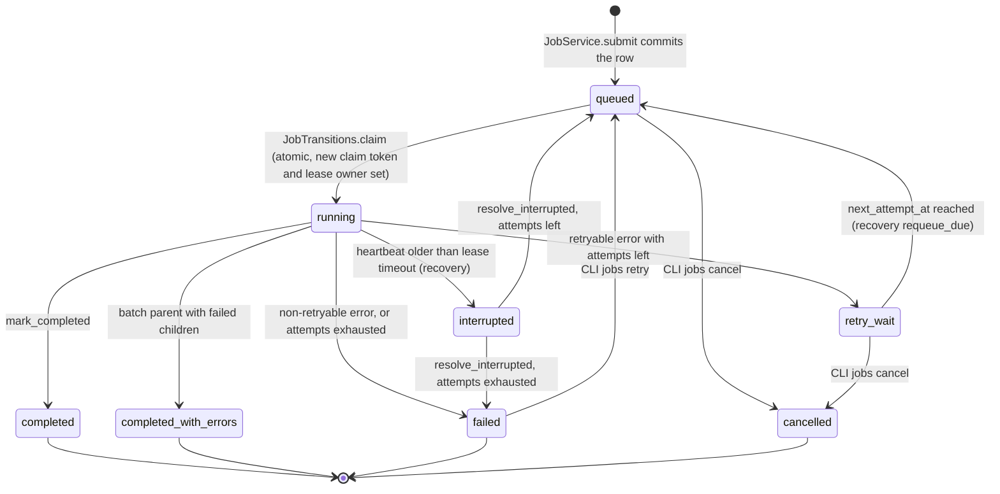
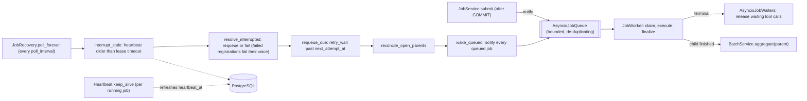
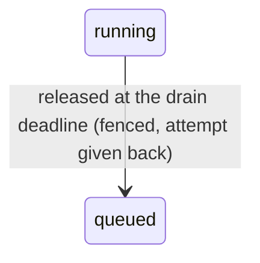

# Job transitions

Every tool that does work creates a job row. The allowed transitions are defined once in `app/domain/jobs.py`
(`_TRANSITIONS`) and enforced by the SQL repository's conditional updates.

## State machine

While a job is `running`, its `phase` moves through `decoding → denoising → vad → inferencing → exporting →
publishing`. A phase is skipped when the pipeline doesn't need it. Every change is persisted by the progress
callback in its own short transaction.

The percentage has fixed checkpoints at each phase, and for TTS at each chunk. Between them, during `inferencing`, it
is an estimate, because the inference libraries report no progress of their own. `InferenceProgress` updates it every
2 seconds from how long similar work recently took on this host. It keeps climbing more slowly and stays below the next
checkpoint. The speed starts as a rough default and is learned in memory per model, and a call that had to load its
model doesn't change it. Only a change of phase is written to the job's event history.

### Registration jobs and their voice

`app/workers/job_transitions.py` owns the rules that keep a `register_voice` job and its voice consistent. Every coupled
job/voice change happens in the same transaction, and only when the job transition itself applied:

- **job completed:** the pending voice becomes ready, with its reference. If the voice is no longer pending (it was
  deleted), the completion becomes a failure instead, so a deleted voice isn't revived.
- **job failed or cancelled** (worker, recovery or CLI): the pending voice becomes failed.
- **job manually retried:** the failed voice becomes pending again. Retrying the job of a deleted voice is refused.
- **automatic retries and recoverable interruptions** leave the voice pending.

Other job types don't touch voices. See also
[voice-registration.md](voice-registration.md#3-completion-makes-the-voice-usable).

## Wake-ups, polling and recovery

The in-process queue only carries hints. PostgreSQL is the source of truth, so a lost wake-up only delays a job,
it doesn't lose it.

- **Transactions are short:** claim, every progress update, and completion each run in their own unit of work.
  Inference and uploads always happen outside a transaction.
- **Publish is idempotent:** `StagedJobAssets` commits each claim's outputs and `outcome.json` before writing the
  `.complete` marker. A retry after a failed upload or commit copies that committed checkpoint into its own claim and
  republishes it without running inference again; a checkpoint with missing files or unreadable metadata is skipped
  and the outputs are regenerated.
- **Orphans:** an object uploaded before a failed commit, or by a claim that lost its job, has no `media_assets` row.
  `AssetReconciler` deletes such objects once they are older than `storage.orphan_retention_hours`.

## Claim fencing

A worker can lose a job without knowing: its heartbeat expires, recovery requeues the job, and another claim takes it.
The old claim's inference may still finish, because a native call cannot be cancelled. Neither `attempt_count` (a
drain refunds it) nor `lease_owner` (`host:pid` reclaims with the same value) tells the two claims apart, so every
successful claim gets a new `jobs.claim_token`, assigned in the same `UPDATE` that moves the job to `running`.

- **Worker writes are fenced in SQL.** Completion, failure, retry scheduling, progress, heartbeat and release all
  update `WHERE id = :id AND status = 'running' AND claim_token = :token` and report whether a row changed.
- **A rejected write means the claim is lost.** `JobTransitions` then records nothing: no event, voice, transcript,
  asset or metrics, and `mark_completed`, `mark_failed` and `schedule_retry` return `None`. The worker resolves no
  waiter, aggregates no batch and removes only that claim's workspace directory.
- **Losing the claim stops the pipeline.** A rejected progress write raises `ClaimLostError`, and a rejected heartbeat
  cancels the handler. A failed heartbeat (the database is unreachable) is logged and retried; it says nothing about
  the claim. A native call may run on after this, so SQL fencing and isolated paths are what guarantee correctness.
- **Every claim has its own files.** The job workspace lives in `jobs/<job>/claims/<token>/`. Outputs, a shared-path original
  and voice references are uploaded under a key containing the token, and only the accepted claim's locations are
  stored. An input uploaded at submission keeps its fixed key and isn't rewritten. A batch manifest has no claim.
- **Recovery and operators are not workers.** `interrupt_stale`, `resolve_interrupted`, `requeue_due` and the CLI's
  `set_status` keep their own status conditions and need no token.

### Upgrading to claim tokens

Migration `7c1d9e3a5b20` adds a nullable `jobs.claim_token`. Existing rows keep `NULL` until their next claim. A
`running` row with `NULL` matches no token, so nothing can finish it; recovery interrupts it once its heartbeat
expires and requeues or fails it under the normal retry budget.

An old worker binary still has unfenced writes, so a mixed-version deployment is not safe. Upgrade in this order:

1. Stop every old worker and wait for it to exit (`python -m app gpu drain`, or stop the process). In the `all` role,
   stop the server. Jobs it was running are recovered as above.
2. Run `python -m app migrate`.
3. Start the new api and the new worker. Do not start an old binary against the migrated database.

To roll back, stop the new processes, migrate down to `4b8e2c6d1f73` and start the old binary. The column and its
fencing go away; stored URIs stay valid because they are opaque, and checkpoints in claim directories are simply not
reused.

## Separate worker process: wake-ups, release and drain

With `deployment.role: api` and a `worker` process (see [gpu-worker.md](gpu-worker.md)):

- **Wake-ups cross processes** through PostgreSQL: the api announces committed jobs with
  `pg_notify('voice_mcp_jobs', job_id)`, the worker `LISTEN`s and feeds its local queue. Missed notifications are
  recovered by the worker's `wake_queued` poll and the api's recovery poll.
- **Recovery runs in the api**, so due retries and stale leases are handled while the worker is stopped. The worker
  keeps only its startup recovery.
- **Release** is one extra, fenced transition outside the state machine table: `running → queued` by
  `jobs.release(job_id, claim_token)` (only while `status = running AND claim_token = :token`). It gives the
  attempt back (`attempt_count - 1`), clears the lease, phase and progress, and records a `released` event. Only a
  worker that reaches its drain deadline uses it. A CLI `retry` can't requeue a running job.

