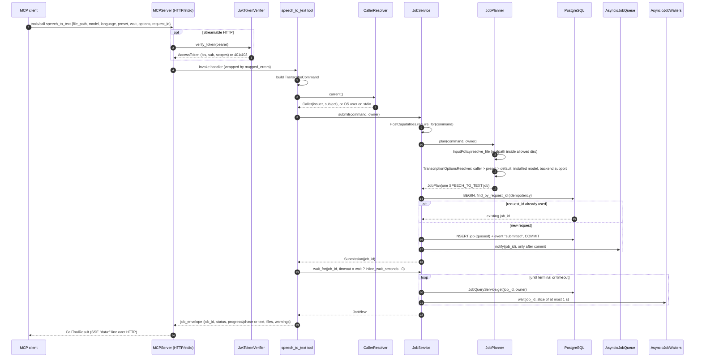
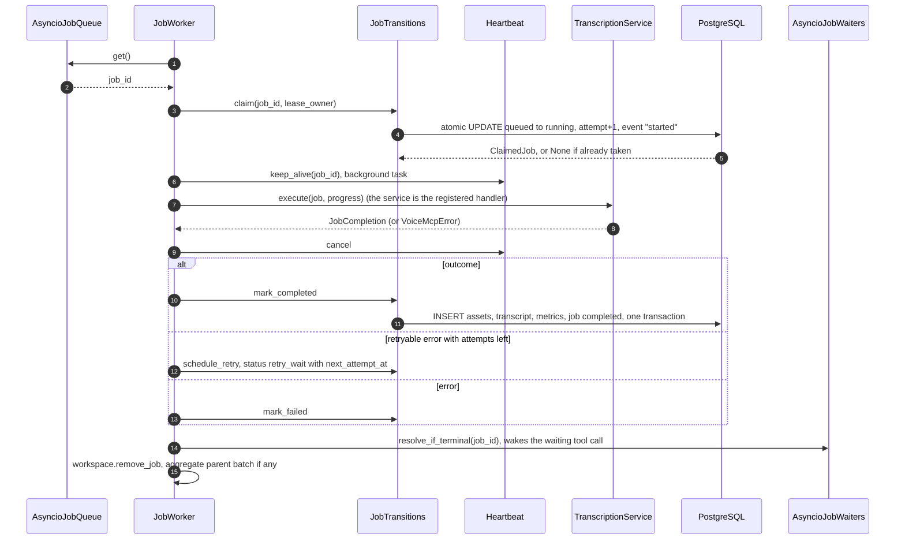
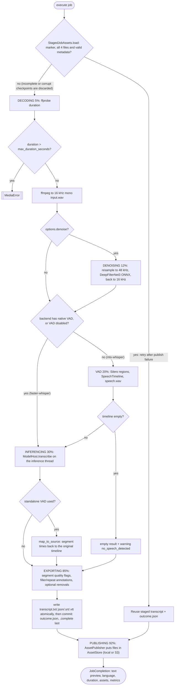

# speech_to_text flow

A file path goes in. Out come `transcript.txt/.json/.srt/.vtt`, plus the text inline when the job finishes within
the inline wait.

## 1. Tool call to job submission

Validation failures (`invalid_request`, `capability_unavailable`, `model_not_installed`, ...) are raised before
anything is committed. `mapped_errors` turns them into `isError: true` with `{"error": {"code", "message"}}`.

## 2. Worker execution

## 3. The transcription pipeline (`TranscriptionService`)

`ModelHost.transcribe` loads the Whisper model lazily on first use and, on small hosts, evicts the TTS
checkpoint first (exclusive residency). On Linux the backend is faster-whisper (CTranslate2), on macOS mlx-whisper.

`transcribe_batch` rejects the whole submission, before any upload or job row, if an accepted file is empty or over
`audio.max_input_bytes`, naming that file. Otherwise it creates a parent job plus one `speech_to_text` child per file in the same transaction. Each
child runs through this same pipeline. After every terminal child, `BatchService.aggregate` updates the parent and
writes `manifest.json` once all children are done.
