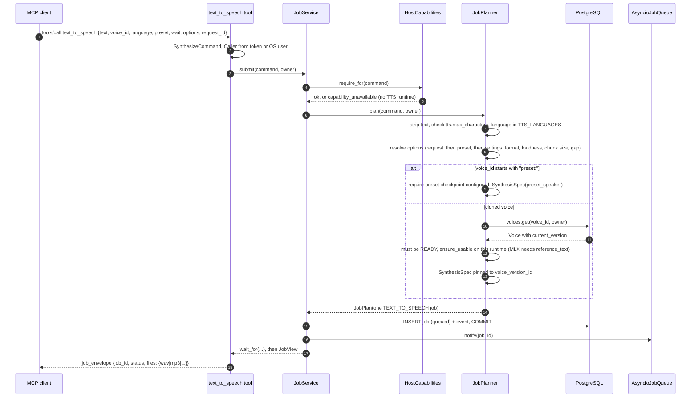
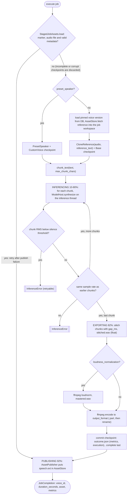
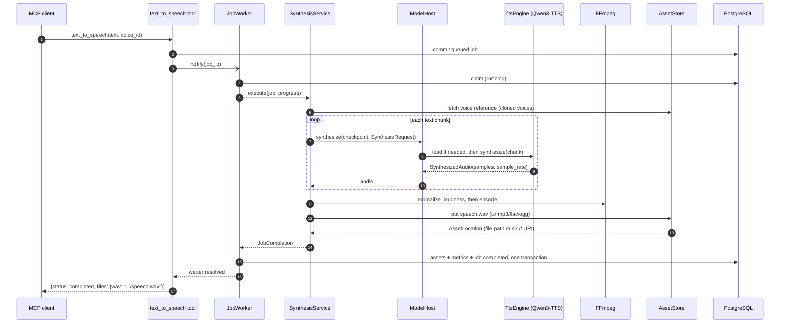

# text_to_speech flow

Text and a `voice_id` go in: either a cloned voice (`voice_...`) or a preset speaker (`preset:<name>`). Out comes
`speech.wav|mp3|flac|ogg`. Submission, worker claim, completion and inline waiting are the same as for
[speech_to_text](speech-to-text.md#2-worker-execution). This page covers what differs.

## 1. Tool call to job submission

Pinning `voice_version_id` at submission keeps a queued job on the exact reference it was planned with, even if
the voice is re-registered later.

## 2. The synthesis pipeline (`SynthesisService`)

`ModelHost.synthesize` loads the checkpoint lazily: `Qwen3-TTS-12Hz-0.6B-Base` for cloned voices,
`...-CustomVoice` for presets. With exclusive residency it unloads the Whisper model first. The engine is
`qwen-tts` on torch (CUDA or CPU) or `mlx-audio` on Apple Silicon. Either way it only turns one text chunk into
samples. Chunking, stitching, mastering and encoding live in the service.

## 3. From MCP call to an audio file, end to end

If the job outlives the inline wait, the client gets `status: running` with `phase` and `progress`. It then calls
`get_job(job_id)` until `files` appears. In S3 mode, `include_download_urls=true` adds presigned URLs.
