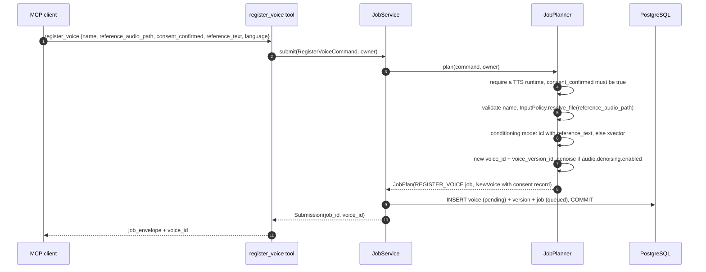
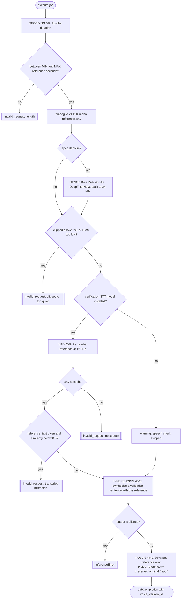
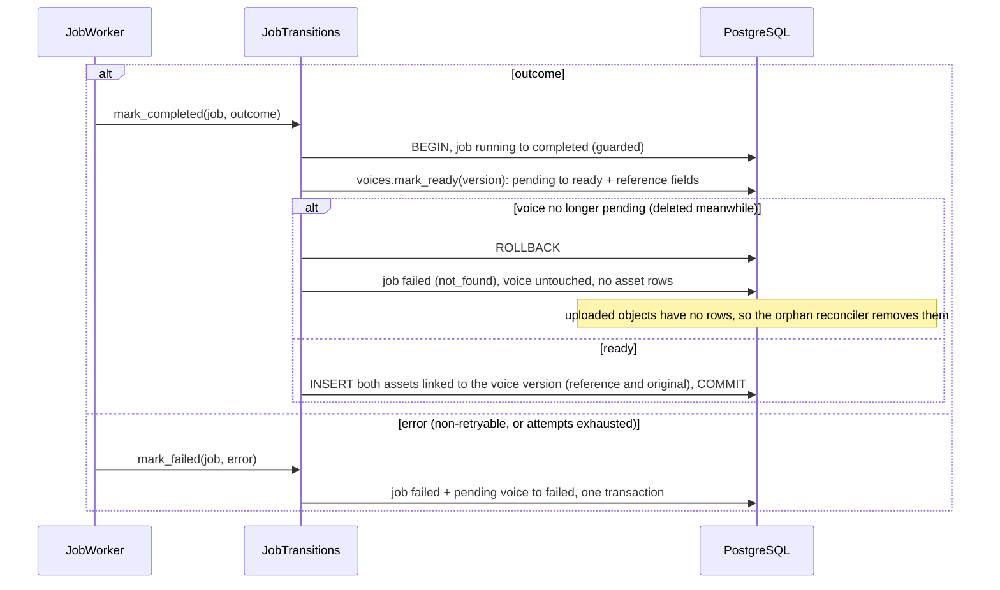

# register_voice flow

A cloned voice has to be registered before `text_to_speech` can use it. Registration is a job like the others.
What makes it different is that the voice row is created **pending** at submission and only becomes **ready**
in the same transaction that completes the job.

## 1. Submission

## 2. Validation pipeline (`VoiceRegistrationService`)

## 3. Completion makes the voice usable

| Event on the registration job | Voice |
|---|---|
| completed | pending to ready |
| failed (worker), interrupted with no attempts left (recovery), cancelled (CLI) | pending to failed |
| automatic retry, recoverable interruption | stays pending |
| `jobs retry` of a failed registration | failed to pending (refused if the voice was deleted) |

Each voice change happens in the same transaction as the job change and only if the job change applied.
`VoiceRepository.mark_ready` updates the voice row (pending to ready) before it attaches the reference fields. The
voice row lock therefore serializes completion with deletion and manual retry, and a deleted or failed voice doesn't
get its reference repopulated. `mark_deleted` refuses a pending voice, because its registration may still complete.
It can be repeated on a deleted voice, keeping the first `deleted_at`, so an interrupted cleanup can be retried. From then
on, `list_voices` shows the voice as ready, and `text_to_speech(voice_id=...)` pins its current version.
`python -m app voices delete VOICE_ID` purges both recordings of every version (see [cli.md](cli.md)).
